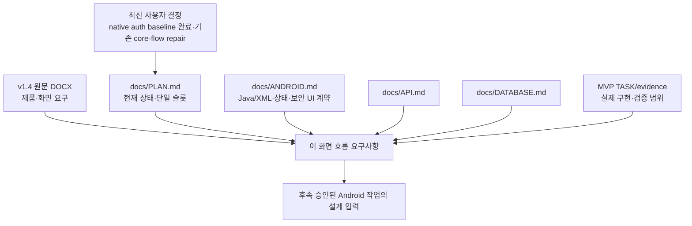
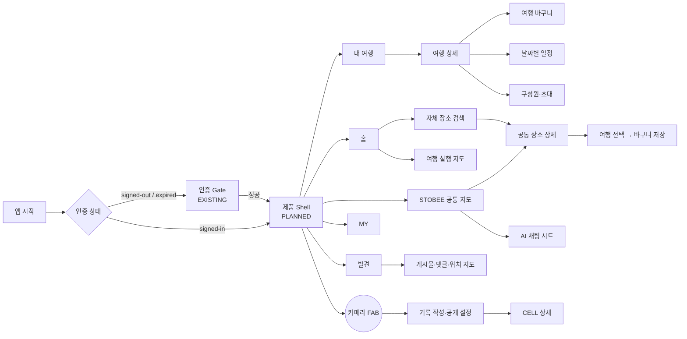

# STOG 화면 흐름·레이아웃 요구사항

> **문서 상태: DOCUMENTATION / DESIGN SPECIFICATION ONLY (2026-11-02)**
>
> 이 문서는 화면 설계와 제품 흐름을 합의하기 위한 요구사항이다. 앱·서버·DB·인증 동작을 새로 구현하거나 런타임으로 검증했다는 주장이 아니다. 현재 구현의 사실은 [PLAN](PLAN.md)과 각 TASK의 evidence를 우선한다. 이 문서로 외부 로그인, 지도, 카메라, 위치, Instagram, SSE 또는 공개 배포의 범위가 승인되는 것은 아니다.

현재 baseline은 native signup/login + 실제 Home/내 여행 two-root shell의 완료된 actual UI pass다. 같은 [NATIVE-AUTH-UI-001](tasks/NATIVE-AUTH-UI-001.md)의 기존 core-flow/layout repair만 추가 승인됐으며 `PENDING / CHECKS NOT_RUN`이다. Gutter/theme/header/Back/compact cover와 기존 native/home/trips/create/detail/search/basket 보존이 범위다. 상세 acceptance는 TASK를 따른다. 아래 전체 제품 목표와 Instagram 설계는 구현 승인이 아니며 Mapbox도 조건부·미연결이다.

## 1. 목적, 원본, 범위

### 1.1 이 문서가 결정하는 것

- 사용자에게 보이는 전체 제품의 **화면 구조, 진입·복귀 흐름, 화면 상태, 정보 우선순위**를 평문으로 고정한다.
- `여행 바구니`와 `여행 일정`이 같은 `TripItem`의 서로 다른 상태이되, 사용자가 보기에 다른 두 계층이라는 점을 명확히 한다.
- 구현된 authenticated travel foundation과 v1.4의 미래 제품 비전을 섞지 않는다.
- 구현 전에 검토 가능한 저충실도 레이아웃과 acceptance 기준을 제공한다.

### 1.2 원본 관계와 우선순위



1. 최신 사용자 결정과 [PLAN](PLAN.md)의 상태가 가장 우선한다.
2. 기능·화면의 제품 기준은 [STOG Android App Project Specification v1.4](../reference/STOG_Development_Starter_v0.1/docs/reference/STOG_Android_App_Project_Specification_v1.4.docx)이다. 이 문서는 DOCX를 로컬 추출하여 확인했다.
3. 화면 상태·복원·개인정보 UI 경계는 [ANDROID](ANDROID.md), wire와 저장 불변조건은 [API](API.md)·[DATABASE](DATABASE.md)를 따른다.
4. 현재 실제 범위는 [MVP-TRIP-001](tasks/MVP-TRIP-001.md), [MVP-TRIP-002](tasks/MVP-TRIP-002.md), [MVP-TRIP-003](tasks/MVP-TRIP-003.md), [MVP-TRIP-004](tasks/MVP-TRIP-004.md)와 현재 단일 슬롯 [NATIVE-AUTH-UI-001](tasks/NATIVE-AUTH-UI-001.md)의 상태로만 판단한다. [MVP-TRIP-005](tasks/MVP-TRIP-005.md) R3c는 deferred다.

### 1.3 상태 표기

| 표기 | 뜻 |
| --- | --- |
| **EXISTING** | source와 TASK evidence로 구현·검증된 부분 화면 또는 동작 |
| **PLANNED** | v1.4에 있는 제품 요구이나 현재 구현·승인은 없는 화면 |
| **PROPOSED VISUAL** | 제품 기능을 추가하지 않는 표현·레이아웃 방향. 구현 전 디자인 검토 필요 |
| **UNDECIDED** | 원문 또는 최신 결정에서 열어 둔 선택. 임의 구현 금지 |

### 1.4 현재 구현과 설계 비전의 경계

**EXISTING / local evidence가 있는 foundation**

- `MainActivity`/`MainFragment` native signup/login/refresh/logout과 실제 Home/내 여행 two-root shell. 이전 Kakao local evidence는 history이며 current Android flow가 아니다.
- `TripList → TripCreate → TripDetail`, edit, member, invitation join 화면.
- `TripDetail → PlaceSearch → PlaceDetail → 바구니 저장`의 Java/XML flow.
- 공통 Place, authenticated trip, privacy-aware cover, basket save의 제한된 local 검증.

**PLANNED / 현재 app composition에 없는 제품 화면**

- 5개 하단 탭(홈·내 여행·STOBEE·발견·MY), 카메라 FAB, 기존 real Home을 넘어서는 전체 제품 대시보드.
- 지도 provider, 여행 실행 지도, CELL, camera recording, 위치 권한/foreground service.
- STOBEE 지도·AI, 발견 피드·댓글·게시물, MY 프로필·EXP.
- Instagram URL 가져오기, 실제 SSE transport·reconnect, 날짜별 일정 편집·동선 변경안.

`MVP-TRIP-005`는 deferred ranked Place search의 **계약/DB 선행조건**이며 현재 repair는 기존 R3a search/detail/basket만 보존한다. 이 문서는 R3c를 앱 화면 완료로 표시하지 않는다.

## 2. 화면 구조와 내비게이션

### 2.1 목표 정보 구조



### 2.2 실제 baseline 경로와 목표 경로를 구분한다

```text
EXISTING (FragmentManager 기반)
native 인증 shell → Home | 내 여행
  └─ 내 여행: TripList ─→ TripCreate ─→ TripDetail
                         ├─ TripEdit
                         ├─ TripMembers / invitation join
                         └─ PlaceSearch ─→ PlaceDetail ─→ basket save

PLANNED (제품 shell)
홈 | 내 여행 | STOBEE | 발견 | MY  +  카메라 FAB
```

목표 shell을 추가할 때에도 인증 전 public browse를 만들지 않는다. 로그인 확장이 최종 단계로 미뤄졌더라도, protected 화면은 기존 signed-in/auth-ended 경계를 유지한다. 설정 누락·토큰 만료·권한 거부는 “공개 모드”가 아니라 명시적 인증/복구 상태다.

### 2.3 Back과 탭 원칙

- 탭 전환은 각 탭의 최상위 상태를 보존한다. 검색어·목록 scroll·선택한 Place/Trip ID처럼 작은 복원값만 보관한다.
- 검색에서 공통 지도/장소 상세로 들어간 Back은 **검색 결과와 scroll 위치**로 돌아간다.
- 여행 상세의 Back은 내 여행 목록의 이전 anchor로 돌아간다.
- 지도 위 바텀시트/채팅/댓글은 먼저 닫고, 그 다음 화면 Back을 적용한다.
- 장소 상세와 STOBEE 채팅은 동시에 쌓지 않는다. 한 번에 하나의 주요 시트만 열린다.
- 인증 종료, logout, 여행 탈퇴/삭제 뒤에는 private payload·미디어·선택 상태를 버리고 해당 resource의 진입점으로 되돌린다.

## 3. 핵심 사용자 여정

| 여정 | 필수 흐름 | 성공의 사용자 관찰 |
| --- | --- | --- |
| 공동 여행 계획 | 내 여행 → 생성 → 초대 → 장소 탐색/가져오기 → 바구니 → 날짜 일정 → 순서/동선 변경안 확인 | 같은 여행 구성원이 같은 바구니·일정을 보며, 적용 전 변경안은 원본을 바꾸지 않는다 |
| 장소를 일정으로 만들기 | 검색/STOBEE/발견/링크 → Place 확인 → 여행 선택 → 바구니 저장 → 날짜 선택 → 일정 이동 | 검색/추출은 즉시 일정을 만들지 않고, 저장 성공 뒤에만 바구니에 나타난다 |
| 여행 실행 | 홈 여행 카드 → 여행 실행 지도 → 날짜 선택 → 번호 마커/동선 확인 | 홈 카드의 목적지는 일반 상세가 아니라 지도+비모달 bottom sheet다 |
| 실제 방문 기록 | 카메라 → 촬영 → 기록/공개 설정 → 동기화 → CELL 지도 | 촬영/활성 기록 세션만 CELL을 바꾸며, 검색·저장으로 CELL이 늘지 않는다 |
| 공개 발견의 재계획 | 발견 피드 → 게시물 장소 선택 → 여행 선택 → 바구니 | 게시물의 모든 장소를 자동 저장하지 않고 선택한 장소만 저장한다 |
| 외부 링크 유입 | 공유/붙여넣기 → URL 확인 → 비동기 후보 → 사용자 확인 → Place 대조 → 바구니 | 후보 추출과 저장을 분리하고, 확인 전 일정·CELL·피드를 바꾸지 않는다 |

## 4. 디자인 시스템과 표현 방향

### 4.1 현재 UI system에서 이어받는 것

현재 Android XML에는 Material 3 theme, `stog_seed` 계열, `space_small/medium/large/extra_large`, `card_corner_radius`, `control_min_height`, surface token과 Material typography가 존재한다. 새 화면은 이를 무시한 임의 pixel, 색, 글꼴을 추가하지 않고 승인된 token 확장으로만 다룬다.

| 항목 | 현재 기반 | 화면 설계 적용 |
| --- | --- | --- |
| 색 | `stog_seed`, Material surface/on-surface semantic color | 지도·사진 위에서는 의미 전달을 색만으로 하지 않고 text/icon을 함께 둔다 |
| 간격 | 8/12/20/32dp 자원 | screen gutter, card, sheet, list rhythm에만 사용 |
| 모서리 | `card_corner_radius` | 가벼운 정보 카드; 지도 sheet는 공간 관계를 유지하는 한 장의 surface |
| 타이포 | Material Display/Headline/Title/Body scale | 화면 제목은 Headline, 메타는 Body/Label로 제한 |
| 상태 | loading/content/empty/error/auth-ended | 같은 화면에서 상충하는 flag를 겹치지 않고 하나의 state로 렌더 |

### 4.2 PROPOSED VISUAL: “발걸음이 계획으로, 계획이 기록으로”

이 디자인은 새 기능이 아니라 v1.4의 기존 연결을 더 읽기 쉽게 보이게 하는 방향이다.

1. **두 개의 시간대** — 바구니는 “아직 날짜가 없는 가능성”, 일정은 “날짜·순서가 있는 약속”으로 다르게 보인다. 같은 Place 카드가 상태 이동할 때 복사본처럼 보이지 않게 한다.
2. **지도는 배경, 결정은 sheet** — 지도 조작을 막지 않는 하단 sheet에서 Place·CELL·여행 실행·대화를 전환한다. 사용자는 지도를 떠나지 않고 다음 행동을 정한다.
3. **CELL은 수집품이 아니라 흔적** — 방문 확인/사진 기록이라는 조건을 surface에서 설명한다. 숫자만 강조하지 않고 “어떤 기록이 이 CELL을 남겼는지”를 보여 준다.
4. **협업의 출처를 짧게** — 바구니/일정 카드의 저장자·출처처럼 이미 모델에 있는 맥락을 작은 메타로 사용한다. 경쟁 제품과의 차별성을 단정하지 않는다.

비교 서비스 조사는 이 작업에서 수행하지 않았다. 따라서 “기존 앱에는 없는 기능” 같은 비교 주장은 **UNVERIFIED**이며, 위 항목은 사용자가 화면에서 관찰할 수 있는 차별화 **가설**이다.

## 5. 전체 화면 인벤토리와 저충실도 레이아웃

이 절의 모든 ASCII 저충실도 다이어그램은 **PROPOSED VISUAL**이다. 정보 우선순위와 전이를 검토하기 위한 설계안이며, 최종 pixel UI·문구·asset·animation을 확정하지 않는다. 화면 제목의 **EXISTING** 표기는 그 화면군의 확인된 동작 foundation에만 적용되며, 특히 S00의 STOG slogan과 도식 layout이 현재 구현 그대로라는 뜻은 아니다.

### S00. 인증 Gate — **EXISTING**

역할: signed-in 여부와 login/refresh/error/logout을 표시하고 protected product로만 진입시킨다.

```text
┌──────────────────────────────┐
│             STOG             │
│      발걸음과 기록을 연결     │
│                              │
│ [현재 인증 상태 / 안내]       │
│ [진행 표시 또는 오류 설명]    │
│                              │
│ [ 로그인 또는 다시 시도 ]     │
│                              │
│ ── signed-in 후 ──            │
│ [현재 trip/item 확인 도구]*   │
└──────────────────────────────┘
* 기존 foundation surface; 최종 제품 홈이 아님
```

- **주요 행동:** login, retry, logout.
- **전이:** 성공/refresh 복원 → 제품 shell(목표) 또는 existing trip foundation; auth-ended → signed-out.
- **상태:** missing config, login in progress, canceled, retryable error, signed-in, logout uncertainty를 구분한다.
- **보안:** access token은 memory-only, refresh는 Keystore 보호; token·UUID·private response를 화면 로그/saved state에 노출하지 않는다.
- **검수:** 설정 부재에서 SDK를 몰래 시작하지 않고 실행 가능한 안내를 보인다. 로그인 연기는 public access로 바뀌지 않는다.

### S01. 제품 shell / 5탭 + 카메라 — **PLANNED**

```text
┌──────────────────────────────┐
│ [화면별 header]               │
│                              │
│         탭 content            │
│                              │
│                         (●)   │ ← 카메라 FAB
├──────────────────────────────┤
│ 홈 │ 내 여행 │ STOBEE │ 발견 │ MY │
└──────────────────────────────┘
```

- **주요 행동:** 5개 주요 목적지 전환, 카메라 실행.
- **전이:** 탭은 root를 교체하며 각 root의 의미 있는 state를 보존한다.
- **상태:** auth-ended면 tab content 대신 auth recovery로 전환한다.
- **검수:** 카메라 FAB는 하단 탭 오른쪽 위에 겹치되 탭 hit area를 가리지 않는다. 이 shell은 현재 구현되어 있지 않다.

### S02. 홈 대시보드 — **PLANNED**

```text
┌──────────────────────────────┐
│ STOG                    [⌕][♡]│
│ 안녕하세요, 이름               │
│ [CELL 수]       [여행 수]      │
│                              │
│ 관광/지역 카드 ──────────→     │
│                              │
│ 내 여행                       │
│ [진행중 여행 카드]             │
│ [예정 여행 카드]               │
└──────────────────────────────┘
```

- **주요 행동:** 검색, 알림(정확한 정책은 미정), 관광 카드, 여행 카드.
- **전이:** 검색 → S06; 단일 Place 관광 카드 → S07; 여행 카드 → S08 여행 실행 지도.
- **상태:** 여행 없음과 관광 콘텐츠 없음은 서로 구분한다. 여행 수는 일상 기록을 포함하지 않는다.
- **검수:** 진행중 → 예정 순이며, 카드의 데이터 원본은 내 여행과 같아도 클릭 목적지는 일반 여행 상세가 아니라 여행 실행 지도다.

### S03. 내 여행 목록 / 생성 — **EXISTING foundation + PLANNED presentation**

```text
┌──────────────────────────────┐
│ 내 여행                       │
│ [진행중] [예정] [지난]         │
│ [여행 카드: cover / 이름 / 기간]│
│ [여행 카드]                    │
│                              │
│ [ + 여행 만들기 ] [초대 참여]  │
└──────────────────────────────┘
```

생성 입력:

```text
┌──────────────────────────────┐
│ ← 새 여행                     │
│ 이름 [                         ]│
│ 지역 [                         ]│
│ 시작일 [      ] 종료일 [      ]│
│ [ 만들기 ]                     │
└──────────────────────────────┘
```

- **주요 행동:** 목록 refresh, 여행 생성, invitation join, 여행 열기.
- **전이:** 생성 성공 → S04; 초대 URI/paste → S05 join; 여행 카드 → S04.
- **상태:** loading/content/empty/retryable/auth-ended; 빈 목록은 생성 CTA를 유지한다.
- **검수:** 날짜 기준으로 진행중·예정·지난 상태를 분류하고, create retry는 같은 사용자 의도를 중복 생성하지 않는다.

### S04. 여행 상세: 개요 / 바구니 / 일정 — **EXISTING partial + PLANNED full**

```text
┌──────────────────────────────┐
│ ← [cover]  제주 여름           │
│    06.10–06.13 · 3명       [⋯]│
│ [편집] [구성원] [초대]          │
│                              │
│ 여행 바구니                    │
│ [Place card  +] [Place card +]│
│                              │
│ [06/10] [06/11] [06/12]  →    │
│ ① 장소명 / 주소             [×]│
│ ② 장소명 / 주소             [×]│
│ [ 동선 짜기 ]                  │
└──────────────────────────────┘
```

- **주요 행동:** edit, members, invitation, add place, 바구니 삭제/일정 이동, 일정 삭제/바구니 이동, 순서 변경, 동선 변경안.
- **전이:** 장소 추가 → S06 또는 S09; `+` → 선택 날짜 일정; 일정 `×` → “바구니로 이동 / 삭제” confirm; 동선 짜기 → S10 proposal.
- **상태:** legacy/ID-only Place는 실제 데이터가 없는 것이므로 대체 label만 표시하고 채워진 Place 카드처럼 꾸미지 않는다.
- **데이터 규칙:** 바구니 저장 성공은 날짜·순서 없는 상태. `+` 성공은 **동일 TripItem 이동**이고 바구니에서 제거한다. 실패 시 양쪽에서 모두 사라지면 안 된다.
- **권한:** ADMIN만 delete, MEMBER만 leave. edit/basket/schedule은 두 역할이 사용할 수 있다. **초대 참여**는 유효 링크의 수신자가 수행하지만, 초대 링크의 발급·공유·재발급·중지는 ADMIN만 수행하며 server가 재검증한다.
- **검수:** 카드 번호·지도 marker·동선 순서가 일치하고, server version 충돌 후 최신 상태를 다시 읽는다.

### S05. 구성원·초대·참여 — **EXISTING foundation**

```text
┌──────────────────────────────┐
│ ← 구성원                       │
│ 나 · ADMIN           [역할][제거]│
│ 민지 · MEMBER        [역할][제거]│
│                              │
│ [초대 링크 공유/재발급/중지]*  │
└──────────────────────────────┘

┌──────────────────────────────┐
│ 초대 참여                      │
│ 링크/토큰 [                    ]│
│ 이름 표기 [                    ]│
│ [ 참여 ]                       │
└──────────────────────────────┘
```

- `*` 초대 링크 발급·공유·재발급·중지는 ADMIN 전용이다.
- **주요 행동:** ADMIN의 member role/remove 및 초대 링크 발급·공유·재발급·중지, MEMBER의 leave, 수신자의 invitation join.
- **전이:** 성공 → S04; 만료/invalid → 복구 가능한 오류; invite가 유효해도 이미 참여한 membership을 취소하지 않는다.
- **상태:** action은 role에 맞게 숨기거나 비활성화하며 server denial도 동일하게 처리한다.
- **개인정보:** member UUID를 화면 label/content description에 표시하지 않는다.
- **검수:** 초대는 10분 신규 참여 제한이며, 비관리자에게 delete/role management와 초대 링크 관리 action을 보여 주지 않는다.

### S06. STOG 자체 장소 검색 — **EXISTING partial**

```text
┌──────────────────────────────┐
│ ← 장소 검색                [×]│
│ [검색어                       ]│
│ [지역(선택)] [카테고리(선택)]  │
│ [ 검색 ]                      │
│                              │
│ [이미지/대체] 장소명           │
│               카테고리·주소    │
│ [이미지/대체] 장소명           │
└──────────────────────────────┘
```

- **주요 행동:** query/filter 입력, clear, submit, retry, result 선택.
- **전이:** 결과 → S07 공통 지도/장소 상세. Back은 현재 query/results/scroll로 복귀.
- **상태:** empty, network error, missing image, missing coordinates를 구분한다. 일반 검색 결과 수에 STOBEE 추천 5개 제한을 적용하지 않는다.
- **데이터 규칙:** result 선택은 TripItem/CELL/AI request를 만들지 않는다.
- **검수:** result·marker·detail·basket이 동일 Place를 참조한다. R3c ranked search는 아직 구현 absent이므로 final rank UI를 완료로 표시하지 않는다.

### S07. 공통 지도 + 장소 상세 sheet — **PLANNED**

```text
┌──────────────────────────────┐
│ ← 장소 위치                   │
│          [지도 / marker]       │
│                              │
│ ┌──────────────────────────┐ │
│ │ 대표 이미지 / 대체          │ │
│ │ 장소명 · 카테고리           │ │
│ │ 주소                         │ │
│ │ [바구니에 저장] [길찾기]     │ │
│ └──────────────────────────┘ │
└──────────────────────────────┘
```

- **주요 행동:** 바구니 저장, 길찾기, STOG 버튼으로 S09 chat으로 전환.
- **전이:** 저장 → S11 여행 선택/저장 confirm; 길찾기 → 지도 route 표시; Back → S06.
- **상태:** image/coordinate 부족은 별도 placeholder/안내. 장소 선택만으로 chat을 자동 시작하지 않는다.
- **검수:** 장소 상세 sheet와 chat sheet가 중첩되지 않고, 지도는 시트 밖에서 계속 이동/zoom 된다.

### S08. 여행 실행 지도 — **PLANNED**

```text
┌──────────────────────────────┐
│ ← 제주 여름                   │
│          [지도 + ①─②─③ 동선]  │
│                              │
│ ┌──────────────────────────┐ │
│ │ 제주 여름                  │ │
│ │ [06/10] [06/11] [06/12]   │ │
│ │ ① 장소 A                   │ │
│ │ ② 장소 B                   │ │
│ └──────────────────────────┘ │
└──────────────────────────────┘
```

- **주요 행동:** 날짜 선택, marker/route 확인, 필요 시 일정 장소 선택.
- **전이:** 홈 카드 → 이 화면; Back → 홈. 장소를 선택하면 공통 Place detail로 이어질 수 있으나 scope 승인 전 새 동작을 고정하지 않는다.
- **상태:** 선택 날짜 일정 없음, route 미생성, map unavailable을 구분한다.
- **검수:** bottom sheet가 지도를 modal로 막지 않으며 marker 번호와 일정 카드 순서가 같다.

### S09. STOBEE 공통 지도 / AI 채팅 — **PLANNED**

```text
┌──────────────────────────────┐
│ STOBEE                 [내 지도]│
│        [현재 위치 / 방향 / 지도]│
│                              │
│                          [STOG]│
│ ┌──────────────────────────┐ │
│ │ 대화 / 추천 장소 최대 5개    │ │
│ │ [장소 카드] [장소 카드]      │ │
│ │ [메시지 입력            ]    │ │
│ └──────────────────────────┘ │
└──────────────────────────────┘
```

- **주요 행동:** 나의 지도 ON/OFF, STOG chat open/close, 질문, 추천 card 저장/길찾기, 공개 기록 marker.
- **전이:** 검색 선택 → S07 장소 sheet; STOG 버튼 → 장소 sheet를 접고 chat; 추천 저장 → S11.
- **상태/권한:** GPS 없음은 임의 위치로 대체하지 않고 위치 확인 상태를 보인다. location permission은 설명 → system request → denied / permanently denied의 순서로 다룬다.
- **데이터 규칙:** 내 지도 ON/OFF는 표시만 바꾸며 CELL 수·EXP·record session을 바꾸지 않는다. 추천은 한 응답 최대 5개이며 “근처”는 현재 GPS 기준이다.
- **검수:** keyboard가 입력창을 가리지 않고, map gesture와 sheet gesture가 분리되며, 공개 지도 응답에 여행 비공개 기록을 섞지 않는다.

### S10. 동선 변경안 확인 — **PLANNED**

```text
┌──────────────────────────────┐
│ ← 동선 변경안                  │
│ 기존  ① A → ② B → ③ C          │
│ 제안  ① B → ② A → ③ C          │
│ [지도 전/후 비교]               │
│ [취소]              [적용]      │
└──────────────────────────────┘
```

- **주요 행동:** 변경안 비교, 적용, 취소.
- **전이:** 적용 성공 → S04/S08 최신 일정; 취소 → 원본 일정; version conflict → 재계산 안내.
- **검수:** 적용 전에는 기존 일정이 전혀 변하지 않는다. 변경안 생성 시점의 `plan_version`과 다르면 stale proposal을 덮어쓰지 않는다.

### S11. 여행 선택 / 바구니 저장 확인 — **EXISTING partial + PLANNED common sheet**

```text
┌──────────────────────────────┐
│ 장소를 여행 바구니에 저장       │
│ [선택 Place / 후보 근거]        │
│ 진행중·예정 여행               │
│ ○ 제주 여름                     │
│ ○ 부산 주말                     │
│ [취소]              [저장]      │
└──────────────────────────────┘
```

- **진입:** S06, S07, S09, S12, S13, S14의 Place 저장 흐름.
- **주요 행동:** target trip 선택, confirmed candidate만 저장, retry.
- **전이:** 성공 → 원래 화면의 saved state; 여행이 없으면 여행 생성 안내 후 입력/후보 보존.
- **상태:** saving, duplicate/replay-safe success, membership/state denial, conflict/reload. 진행중·예정 여행만 선택한다.
- **검수:** 복수 후보/복수 장소는 사용자가 선택한 것만 저장하고, 추출/검색은 일정·CELL·EXP·발견 post를 만들지 않는다.

### S12. Instagram 링크 가져오기 — **PLANNED / current M2 not started**

```text
┌──────────────────────────────┐
│ ← Instagram 링크 가져오기      │
│ URL 또는 공유 텍스트            │
│ [                            ] │
│ [확인]                         │
│                              │
│ 작업 상태: URL 확인 → 후보 → 대조│
│ [□ 후보 A / 원문 주소 / 근거]  │
│ [□ 후보 B / 연결 미확인]       │
│ [선택 장소를 바구니에 저장]     │
└──────────────────────────────┘
```

- **주요 행동:** URL/share text 확인, 작업 상태 확인, 후보 선택, common Place 대조, S11 저장.
- **전이:** 인증이 없으면 login 뒤 입력을 복원하되 login 전 자동 browser 작업을 시작하지 않는다.
- **상태:** access failed, caption 없음, candidate 없음, address 없음, match ambiguity, save failed를 구분한다. 검증되지 않은 % progress/success를 표시하지 않는다.
- **데이터/개인정보:** external link는 장소 유입의 출처일 뿐 외부 photo/video 재게시물이 아니다. raw caption·private data를 log/render에 불필요하게 노출하지 않는다.
- **검수:** 사용자 확인 전 basket/schedule/CELL/feed가 변하지 않고 재시도가 duplicate를 만들지 않는다. 현재는 M2 `NOT_STARTED`; 카카오·네이버 지도 공유는 더 뒤의 후속이다.

### S13. 카메라 촬영 / 기록 작성 — **PLANNED / current M3 not started**

```text
┌──────────────────────────────┐
│ [촬영 preview]                 │
│                         [셔터] │
└──────────────────────────────┘

┌──────────────────────────────┐
│ ← 기록 작성                    │
│ [사진]                         │
│ 메모 [                         ]│
│ 공개  ○ 공개                    │
│ 여행 기록: ○ 비공개(여행 구성원 공개)│
│ 일상/비여행: ○ 비공개(나만)     │
│ [저장]                         │
└──────────────────────────────┘
```

- **주요 행동:** camera permission, 촬영, 메모, 공개 범위 선택, 저장.
- **전이:** 저장/동기화 성공 → S14 CELL; 지연/오프라인 → pending indicator를 유지하고 확정 CELL과 구분한다.
- **권한:** 설명 → Android system camera/location permission → granted/denied/permanently denied를 명시한다. location은 촬영 시점의 위치를 보관하며 허용하지 않으면 임의 좌표로 채우지 않는다.
- **개인정보:** 여행에 연결된 비공개 사진은 “비공개(여행 구성원 공개)”로 표시하고 작성자+해당 여행 구성원이 열람한다. 여행과 무관한 일상/개인 비공개 사진은 “비공개(나만)”으로 표시하고 작성자만 열람한다. 기록 문맥에 따라 하나의 정확한 audience label만 보인다.
- **검수:** search/gallery/import/basket만으로 CELL을 활성화하지 않는다. M3 승인 전 camera/queue/permission runtime을 구현하지 않는다.

### S14. CELL 상세 / 여행 기록 세션 — **PLANNED**

```text
┌──────────────────────────────┐
│          [지도 CELL layer]     │
│ ┌──────────────────────────┐ │
│ │ 사용자 친화 위치명          │ │
│ │ [최신 사진 → →]             │ │
│ │ 사진 없음 / 방문 기록        │ │
│ │ 메모                         │ │
│ └──────────────────────────┘ │
│ [기록 시작 / 중지 / 종료]      │
└──────────────────────────────┘
```

- **주요 행동:** CELL 선택, 기록 session start/stop/end, 사진 browse.
- **상태:** empty photo cell, pending sync, active session, stopped, ended, location unavailable.
- **데이터 규칙:** session은 사용자가 명시적으로 시작/중지/종료한다. 지도 화면 OFF는 session 종료가 아니다. 중지/종료 후 새 위치는 방문으로 넣지 않는다.
- **검수:** 같은 CELL의 최신 열람 가능 사진이 대표 이미지이고, 동일 CELL은 여러 기록이 있어도 한 번만 CELL count를 올린다.

### S15. 발견 피드 / 게시물 상세 — **PLANNED**

```text
┌──────────────────────────────┐
│ [+]          발견          [♥]│
│ 프로필 · 이름                  │
│ [사진 swipe ───────────────]  │
│ [좋아요] [댓글]        [바구니] │
│ 이름  게시물 텍스트             │
│ 날짜                            │
└──────────────────────────────┘
```

- **주요 행동:** post create 진입, liked posts, photo carousel, like, comment sheet, profile, 선택 Place 저장.
- **전이:** comment → S16, 사진 위치 icon → 공통 지도, 선택 장소 → S11.
- **상태:** 위치 없는 gallery post는 지도 이동을 비활성/미노출 처리한다.
- **개인정보:** 공개를 선택한 사진만 feed/public map에 노출한다. 여행 구성원 열람 가능 사진이 자동으로 공개되는 것은 아니다.
- **검수:** 게시물의 모든 장소/현재 slide 장소를 자동 저장하지 않는다.

### S16. 게시물 작성 / 댓글 — **PLANNED**

```text
┌──────────────────────────────┐
│ ← 게시물 작성                  │
│ [갤러리 선택 사진]              │
│ 내용 [                         ]│
│ [등록]                         │
└──────────────────────────────┘

┌──────────────────────────────┐
│ 댓글                           │
│ 프로필 이름  댓글               │
│ 프로필 이름  댓글               │
│ [댓글 입력                  ]   │
└──────────────────────────────┘
```

- **주요 행동:** gallery general post 작성, comment 작성, commenter profile 선택.
- **전이:** profile → S17; close → S15.
- **상태:** upload/write failure와 empty comment를 구분한다.
- **검수:** 일반 갤러리 post, 여행 공개 사진 post, 일상 camera photo post를 혼동하지 않는다.

### S17. MY 프로필 / 활동 그리드 — **PLANNED**

```text
┌──────────────────────────────┐
│ [프로필] 이름                  │
│ 레벨 N · 단계 수식어            │
│ CELL 수    여행 수    좋아요 수 │
│                              │
│ [□][□][□]                      │
│ [□][□][□]  3열 게시물 grid     │
│ [□][□][□]                      │
└──────────────────────────────┘
```

- **주요 행동:** profile image 변경, grid post 열기.
- **전이:** grid item → 해당 사용자 post 흐름. 나의 지도는 별도 MY map이 아니라 S09의 ON/OFF layer다.
- **상태:** no posts, profile image upload/change failure, metrics loading.
- **EXP:** CELL 최초 활성화와 record 등록은 v1.4에 EXP 원인으로 있으나 정확한 지급량/곡선은 **UNDECIDED**다. 숫자·레벨 산식을 임의 구현하지 않는다.
- **검수:** CELL/여행/좋아요 수는 server 값과 일치하고 3열 grid는 폭에 균일하게 맞는다.

## 6. 공통 상태, 오류, 권한, 개인정보

### 6.1 화면 상태 contract

| 상태 | 표현 | 행동 |
| --- | --- | --- |
| Loading | 현재 요청 범위가 보이는 progress + 중복 제출 방지 | read retry와 mutation retry를 혼동하지 않는다 |
| Content | 실제 server/approved local data | 오래된 callback은 request identity로 무시 |
| Empty | 성공했지만 항목 없음 | 다음 의미 있는 CTA를 제공 |
| Error | 짧고 action 가능한 오류, 내부 정보 비노출 | 유효한 경우만 retry |
| Auth-ended | token/refresh 종료 후 private content 제거 | 인증 Gate로 전환 |
| Conflict | 최신 version과 다름 | 최신 data reload 후 재확인 |
| Permission denied | 필요한 이유와 system settings 재진입 안내 | 임의 위치/권한 우회 금지 |

### 6.2 권한과 민감 데이터

- camera, precise/foreground/background location, notification/foreground service 등은 M3 승인 TASK 전까지 **PLANNED**다.
- Location permission이 없거나 GPS를 얻지 못하면 “근처”/record 방문 조건을 임의 좌표로 대체하지 않는다.
- private travel media는 작성자와 해당 여행 구성원만 열람할 수 있다. metadata, thumbnail, file, cover도 같은 authorization 뒤에만 표시한다.
- 여행과 무관한 개인/일상 private media는 작성자만 열람할 수 있으며, 여행 구성원이라는 이유만으로 접근할 수 없다. UI는 문맥에 따라 `비공개(여행 구성원 공개)` 또는 `비공개(나만)`을 정확히 표시한다.
- 공개 지도·발견 feed에는 공개 record만 포함한다. 여행 비공개와 공개 feed 여부는 별도의 선택이다.
- raw GPS 좌표를 UI에 그대로 노출하지 않고 사용자 친화적인 위치명으로 바꾼다.
- token, provider credential, private file path, raw caption, personal GPS, full private response는 log/saved state/evidence에 남기지 않는다.

### 6.3 바구니·일정·CELL 불변조건

```text
Place 확인
  └─ 명시적 저장 성공 → TripItem: basket (날짜 없음, 순서 없음)
       └─ 일정 이동 성공 → 같은 TripItem: schedule (날짜·순서 있음)
            └─ 일정 X → basket으로 이동 또는 삭제

CELL 활성화
  = STOG camera record 저장 OR 사용자가 시작한 active travel-record session 방문 확인
  ≠ 검색 / Place detail / 링크 import / 바구니 저장 / gallery 등록
```

## 7. 화면별 완료 acceptance 요약

| 화면군 | 완료로 판단할 최소 관찰 |
| --- | --- |
| 인증 | missing-config, login/retry/logout/auth-ended가 public bypass 없이 구분됨 |
| 홈/탭 | tab 상태와 FAB가 충돌하지 않고, home trip은 실행 지도에 진입함 |
| 여행 | create/list/detail, role, invitation, basket↔schedule 이동, plan conflict가 server result와 일치 |
| 검색/Place | query/result/detail/back state가 복원되고 selection만으로 저장/AI/CELL이 생기지 않음 |
| 지도/STOBEE | map gesture와 sheet gesture가 공존하며 one-sheet rule, GPS unavailable, private/public layer가 구분됨 |
| 기록/CELL | permission, pending sync, session stop/end, photo-less CELL, privacy audience가 관찰 가능 |
| 발견/MY | 공개 선택만 feed에 보이고 선택 장소만 basket 저장, profile metrics/grid가 server state와 일치 |
| 링크 import | 입력·후보·대조·사용자 선택·저장을 구분하고, 확인 전 state mutation이 없음 |

## 8. 발표용 짧은 내러티브

STOG는 장소를 “찾는” 데서 끝나지 않는다. 사용자는 발견한 Place를 먼저 **여행 바구니**에 모아 협업으로 검토하고, 날짜와 순서를 정한 뒤에야 **일정**으로 옮긴다. 여행 중에는 카메라 기록과 사용자가 시작한 기록 세션이 실제 발걸음을 CELL로 남긴다. 그래서 계획은 기록으로 이어지고, 공개를 선택한 기록은 다시 다른 사람의 발견과 다음 여행 계획으로 돌아온다.

보이는 차별화 가설은 세 가지다: (1) 저장과 일정 확정을 섞지 않는 두 계층, (2) 단순 저장이 아닌 실제 기록 조건을 가진 CELL, (3) 검색·AI·기록·실행을 하나의 지도 문맥으로 이어 주는 비모달 sheet다. 이는 경쟁 제품 조사 결과가 아니라, 이 명세에 이미 있는 사용자 행동을 더 선명하게 보이게 하는 설계 가설이다.

## 9. 열어 둔 제품 선택

| 선택 | 현재 상태 |
| --- | --- |
| 정확한 tab shell token/시각 자산/animation | PROPOSED VISUAL, 디자인 검토 필요 |
| 알림 화면의 범위 | UNDECIDED |
| 홈 방문 지역 수 | **CONFIRMED (2026-11-02 사용자 결정):** 사용자가 채운 CELL이 속한 시·군·구 수로 센다. 여행 계획의 지역명으로 세지 않는다. CELL 기록 기능이 없어 현재 값은 0 |
| 홈 배너 사진 | **CONFIRMED (2026-11-02 사용자 결정):** 앱 UI는 흑백을 유지하되 배너 사진은 컬러로 둔다 |
| 관광 카드 중 단일 Place가 아닌 콘텐츠의 상세 목적지 | UNDECIDED |
| MY EXP 지급량·레벨 산식 | UNDECIDED |
| 여행 기간 단축 시 범위 밖 일정 처리 | **현재 backend 규칙:** 범위 밖 일정이 생기는 기간 변경은 전체 edit를 거부하고 기존 기간·일정 항목을 보존한다. 항목 이동/보존을 돕는 별도 UX는 필요 시 PROPOSED로만 검토하며, 현재 승인된 대체 정책이 아니다 |
| Mapbox, 비용/계정, permission copy, recording service lifecycle | Mapbox는 무료 조건·강제 무과금 통제 VERIFIED + 별도 지도 작업 승인 후에만 도입; 실제 연결 NOT_STARTED. 권한/기록 service도 별도 승인 필요 |
| Instagram helper/access/storage/retention/cost | NOT_STARTED / 별도 승인 필요 |
| 외부 로그인 provider 확장·최종 연동 | 제품 최종 단계까지 보류; 기존 auth/privacy 보존 |

## 10. 이 문서의 구현 금지선

- 외부 로그인 연기를 이유로 로그인 bypass나 public browse를 만들지 않는다.
- R3c 계약을 이유로 Android search/map UI를 새로 구현하지 않는다.
- map, location, camera, CELL, EXP, Discover, MY, STOBEE, Instagram을 “문서에 있으므로 승인됨”으로 해석하지 않는다.
- 경쟁 앱이 특정 기능을 “없다”고 주장하지 않는다. 비교 검증은 이 작업 범위가 아니다.
